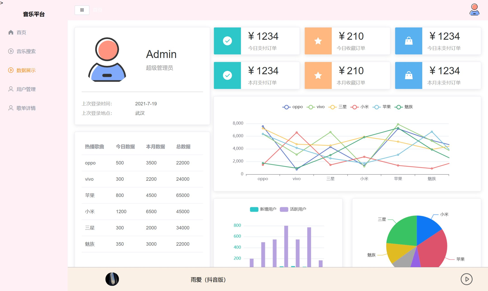
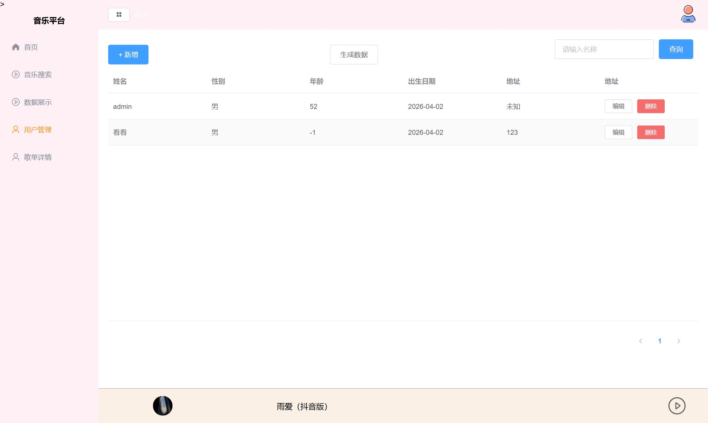

# 河大放假音乐网 · music-platform

一个前后端分离的音乐网站：**Vue2 前端 + Flask 后端 + MySQL**，歌曲与歌单数据来自第三方网易云音乐 API。


## 组成（三个部件，缺一不可）

| 部件 | 目录 | 端口 | 说明 |
| --- | --- | --- | --- |
| 前端 | `music-web-vue2/` | 8080 | Vue2 + element-ui + ECharts，hash 路由 |
| 后端 | `music-server-flask/` | 5000 | Flask + PyMySQL + PyJWT，提供登录/菜单/用户 CRUD/图表数据 |
| 音乐数据服务 | `NeteaseCloudMusicApi-master/`（**不在本仓库**） | 3000 | 第三方 Node 服务，提供轮播、歌单、搜索 |

> ⚠️ **3000 那个服务是硬性依赖**：不启动它，首页轮播和歌单会是空白，搜索页也搜不出东西。
> 它体积大（含 `node_modules` 近 200MB）且非本项目代码，所以没有入库，需要自己 clone。

## 技术栈

- **前端**：Vue 2.6 / vue-router 3 / vuex 3 / element-ui / ECharts 5 / axios / less
- **后端**：Flask 3 / flask-cors / PyJWT / PyMySQL
- **数据库**：MySQL 8（表结构见 `music-server-flask/docs/database/schema.sql`）
- **第三方**：[NeteaseCloudMusicApi](https://github.com/Binaryify/NeteaseCloudMusicApi)

## 快速开始

前置：Node ≥ 18（含 pnpm）、Python ≥ 3.10、MySQL 8。

**1. 建库**

```bash
mysql -uroot -p < music-server-flask/docs/database/schema.sql
```

**2. 启动网易云 API（:3000）**

```bash
git clone https://github.com/Binaryify/NeteaseCloudMusicApi.git NeteaseCloudMusicApi-master
cd NeteaseCloudMusicApi-master && npm install && node app.js
```

**3. 启动后端（:5000）**

```bash
cd music-server-flask
python -m venv .venv && source .venv/bin/activate      # Windows: .venv\Scripts\activate
pip install flask flask-cors pyjwt pymysql
export MUSIC_DB_PASSWORD=你的MySQL密码                  # Windows PowerShell: $env:MUSIC_DB_PASSWORD="..."
python app.py
```

**4. 启动前端（:8080）**

```bash
cd music-web-vue2
pnpm install
pnpm serve
```

打开 <http://localhost:8080>，默认账号 `admin` / `123456`。

> 已经装好依赖的话，可以在仓库根目录直接跑 `bash scripts/dev.sh` 一键拉起三个服务（密码从环境变量或 `.env` 读取）。

## 截图

| 数据展示（ECharts） | 用户管理（MySQL CRUD） |
| --- | --- |
|  |  |

登录页见 [`docs/screenshots/01-login.jpg`](docs/screenshots/01-login.jpg)。

## 环境变量

后端数据库连接全部从环境变量读取（`music-server-flask/sqlmanager.py`），密码不落在代码里：

| 变量 | 默认值 |
| --- | --- |
| `MUSIC_DB_HOST` | `127.0.0.1` |
| `MUSIC_DB_PORT` | `3306` |
| `MUSIC_DB_USER` | `root` |
| `MUSIC_DB_PASSWORD` | *(空，必须自己设)* |
| `MUSIC_DB_NAME` | `music_platform` |

## 目录结构

```
music-platform/
├── music-web-vue2/                 # 前端
│   ├── src/
│   │   ├── views/                  # 登录 / 首页 / 音乐搜索 / 数据展示 / 用户管理
│   │   ├── components/             # 轮播、歌单列表、底部播放条
│   │   ├── router/                 # 静态路由 + 登录后动态注入菜单
│   │   ├── store/                  # vuex：菜单、权限
│   │   ├── utils/request.js        # axios 实例 → Flask(5000)/api
│   │   └── request/index.js        # axios 实例 → 网易云 API(3000)
│   └── .npmrc                      # pnpm 配置（vue-cli 需要 shamefully-hoist）
├── music-server-flask/             # 后端
│   ├── app.py                      # 所有接口（登录/菜单/用户 CRUD/图表数据）
│   ├── sqlmanager.py               # 数据库访问层
│   └── docs/database/schema.sql    # 建表脚本
├── docs/screenshots/               # 运行截图
└── scripts/dev.sh                  # 一键启动三个服务
```

## 设计说明

- **为什么前后端放一个仓库**：后端只有 ~350 行、历史提交个位数，而前端离开后端和网易云 API 都跑不起来 —— 拆成两个仓库反而让「clone 下来跑不起来」的门槛更高。三个部件放一起，README 一处讲清启动顺序即可。
- **前端为什么需要 `.npmrc` 的 `shamefully-hoist`**：`@vue/cli-service` 5 依赖扁平的 `node_modules`，pnpm 默认的严格隔离会导致 `Cannot find module '@babel/preset-env'`。

## 已知问题

- `src/utils/request.js` 与 `src/request/index.js` 是两套 axios 封装，分别指向 5000（业务接口）和 3000（音乐数据），地址是写死的，换机器/换端口需手动改。
- `babel.config.js` 里 `@babel/preset-env` 与 `@vue/cli-plugin-babel/preset` 重复配置了一份，可精简。
- 密码是明文比对（课程项目水平），**不要用于任何真实场景**。
- 菜单里 `/page1`、`/page2`、`/songspage` 等页面仍是占位。

## License

MIT
